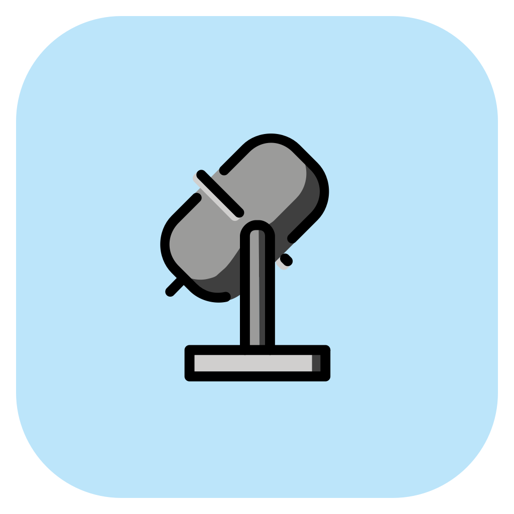

#  oollim

**Expert L2 English speech evaluation on a gaming PC**

*oollim* takes its name from the Korean **울림**: the resonance of a voice and the impression it leaves.


[](LICENSE.md)

[](https://doi.org/10.5281/zenodo.23467863)
[](https://doi.org/10.5281/zenodo.23468266)

## 🚀 Install

Download an installer from the [latest release](https://github.com/cburst/oollim/releases/latest). 

| Platform | Download |
|---|---|
| 🍎 Apple Silicon Mac | [oollim-mac.zip](https://github.com/cburst/oollim/releases/latest/download/oollim-mac.zip) |
| 🪟 Windows · Intel/AMD 64-bit | [oollim-windows.exe](https://github.com/cburst/oollim/releases/latest/download/oollim-windows.exe) |

### 🍎 macOS

1. Extract **oollim-mac.zip** and open **Install oollim.app**.
2. Follow the instructions and keep Terminal open while dependencies and models download.
3. The evaluation window opens when setup finishes. Reopen oollim from **~/Applications** afterward.

The published Mac package is Developer ID signed and notarized by Apple. macOS may ask you to confirm opening a downloaded app. **Homebrew is required** for the Pango PDF library: if setup reports that Homebrew is missing, install it from [brew.sh](https://brew.sh), then reopen oollim. Setup installs Pango when Homebrew is available.

### 🪟 Windows

1. Run **oollim-windows.exe** and follow the installer.
2. Open the **oollim desktop or Start menu shortcut**.
3. Keep the setup window open while dependencies and models download.

The Windows installer is **unsigned**. If SmartScreen displays “Windows protected your PC,” choose **More info → Run anyway** after confirming the download came from this repository. Managed computers may restrict this option.

### 💾 Setup, privacy, and troubleshooting

- Allow approximately **10 GB** for dependencies and models, plus temporary download space. Initial setup needs internet access; speech evaluation runs locally.
- Recordings are not sent to a cloud scoring service. Application files, environments, caches, models, and default results are stored under **oollim in your home folder**.
- First setup takes longer than later launches. If setup fails, resolve the displayed error and reopen oollim to retry. Removing a shortcut does not remove downloaded models or results.
- Start with a short recording: memory use rises sharply with duration, and CPU inference is not real time. Close memory-heavy applications if needed.
- For support, include your operating system, error message, and relevant setup log. Do not post private recordings or credentials.

Short-audio scoring and PDF generation have passed native Mac GUI testing and interactive **Windows Server 2022** testing, including the Windows installer wizard. **Windows 11 has not been independently verified.** Signing and notarization were subsequently completed by the author; test the signed Mac package before publishing. See [installation troubleshooting](docs/INSTALL.md) and [native build notes](packaging/README.md).

### 🧰 Install from source

Install native **64-bit Python 3.11** from [python.org](https://www.python.org/downloads/), extract this repository into a writable folder, and open a terminal there.

```sh
# macOS
python3.11 install.py
python3.11 oollim.py --gui
```

```powershell
# Windows
py -3.11 install.py
py -3.11 oollim.py --gui
```

The installer creates a `.venv`, installs dependencies and FFmpeg, and downloads pinned speech encoders with progress indicators. PDF export uses WeasyPrint 70.0 with Homebrew Pango on Mac and a verified standalone runtime on Windows. Omit `--gui` for terminal prompts and the Rich dashboard.

Use `install.py --plan` to preview setup, `--skip-models` to defer model downloads, or `--current` to use the invoking Python environment. Do not run the source installer with sudo or administrator privileges.

## 🖥️ Desktop interface

Select **Audio**, browse to a plain-text **Reference text** file, choose the **Results** location and **Scoring** family, then click **Evaluate**. Click **Open PDF** when processing finishes. The GUI handles one recording at a time; folder processing is available through the command line.

The CSV contains whole-recording scores. The PDF includes sentence-level accuracy, fluency, and prosody, plus **experimental, uncalibrated word-accuracy highlights**. Word highlights are phone-support scores, not validated diagnoses of individual pronunciation errors. See the sentence and word report notes below.

## 🎧 Score a recording or folder

A reference transcript is required. On macOS:

```sh
# 🎵 One recording and its transcript
python3.11 oollim.py --audio "recording.m4a" --transcript "reference.txt" --output scores.csv

# 📁 A folder sharing one reference text
python3.11 oollim.py --folder "audio" --transcript "reference.txt" --output scores.csv

# 📝 A folder with a matching .txt transcript beside each recording
python3.11 oollim.py --folder "audio" --recursive --output scores.csv

# 🧪 Choose a different training family
python3.11 oollim.py --folder "audio" --transcript "reference.txt" --family korean --output korean.csv
```

🪟 On Windows, replace `python3.11` with `py -3.11` in these commands.

- 🎬 FFmpeg decodes supported audio and video containers automatically.
- ⏱️ Whole recordings must be **0.25–120 seconds** and no larger than **400 MiB**.
- 📊 Output includes accuracy, fluency, and prosody scores on the trained **0–10 scale**. Raw ridge predictions can exceed those endpoints; no silent clipping or calibration is applied.
- 🔄 Keep the CSV and its `.state.json` companion to resume. Rerun the same command; add `--retry-failed` to retry failures.
- 🩺 Run `oollim.py --doctor` with the same Python launcher to check dependencies and model assets.

## 🧠 What produces the scores?

Frozen **XLS-R**, **XEUS**, and **PhoneticXeus** representations combine with reference-phone diagnostics and supervised **ridge regression**. The encoders remain fixed; the scoring coefficients are trained. Each construct can use its own representation combination and training family.

| 🎯 Construct | 🧩 Representation in the completed family study |
|---|---|
| Accuracy | XEUS + PhoneticXeus + 17 reference-phone diagnostics |
| Fluency | XEUS + XLS-R |
| Prosody | XEUS + XLS-R |

👪 Seven training families are included: `speechocean` (default), `korean`, `aesop`, `koreanocean`, `aesopocean`, `koreanaesop`, and `aesopkoreanocean`.

## 🔬 Reproduce the work

### ⚡ Fast tests and published tables

These checks require **no corpus, encoder weights, API credential, GPU, or paid service**. From the repository folder on macOS:

```sh
python3.11 -m venv .venv
.venv/bin/python -m pip install -e '.[test,evaluation]'
.venv/bin/python -m pytest -q
.venv/bin/python -m reproduce.tables
```

On Windows PowerShell:

```powershell
py -3.11 -m venv .venv
.\.venv\Scripts\python.exe -m pip install -e '.[test,evaluation]'
.\.venv\Scripts\python.exe -m pytest -q
.\.venv\Scripts\python.exe -m reproduce.tables
```

📊 [Completed development tables](results/seven-families-v1.md) report all 63 aggregate comparisons; the underlying data are in `results/seven-families-v1.json`.

### 🏋️ Corpus preparation, extraction, and training

Follow the [experiment reproduction guide](docs/REPRODUCE.md) for acquisition, corpus preparation, feature extraction, training, and evaluation. Using your environment’s Python:

```sh
python -m reproduce.prepare --help
python -m reproduce.extract --help
python -m reproduce.train --help
```

🗂️ `reproduce/` provides portable entry points, `speech/pronunciation/` contains encoder and scoring implementations, and `models/` holds the trained ridge bundles. `speech/scripts/` preserves historical research runners with their experiment-specific layouts.

✅ The seven-family evaluation, **315-configuration representation ablation**, and paired external comparisons are complete. The paired analysis uses **200,000 bootstrap replicates** and a second-seed stability check. The ablation retains the **.01 promotion threshold**; `configs/selected-constructs.json` records the unchanged overall selections: koreanocean accuracy and aesopkoreanocean fluency/prosody. Full ablation results are in `results/ablation-mac-v1/`.

🔎 The portable solver is checked against direct normal equations and the historical solver, with synthetic integration tests. A complete clean-environment raw-corpus → encoder → seven-family rerun has **not** been performed for this release. Pinned source and model manifests support that verification; see [validation details](docs/VALIDATION.md).

## 🧑‍🏫 Independent evaluation

Evaluation runs locally through `oollim.py`. Offline commands in `evaluation/run_statistics.py` and `reproduce/external_tables.py` regenerate the compact paper table and supplementary comparisons. `evaluation/statistics.py` preserves the Spearman, QWK, and paired-bootstrap calculations. Private ratings remain on the evaluator’s machine.

## 📌 Scope and provenance

- 🔒 No private recordings, row-level ratings, credentials, or dataset archives are included; private evaluation data are not used for training or calibration.
- 📦 Small ridge heads for all seven families are released with permissions confirmed by the author, under the [non-commercial weight terms](models/WEIGHTS-LICENSE.md). Encoders download separately. See [rights and restrictions](docs/RIGHTS.md).
- 🧭 Development partitions guide model choices; reserved final partitions remain excluded.
- 🔍 Speaker-disjoint splits do not resolve possible pretrained-model exposure to evaluation corpora.
- 🏷️ The default SpeechOcean bundle is the original API-evaluated ridge. The matched fresh SpeechOcean refit uses the standardized family-comparison training procedure and has different coefficients; results belong to their respective versions.

## 📄 Paper and supplementary materials

- 📚 [arXiv-format paper with all appendices](paper/oollim-arxiv.pdf) · [LaTeX source](paper/oollim-arxiv.tex)
- 🎤 [Interspeech-format paper](paper/oollim-interspeech.pdf) · [LaTeX source](paper/oollim-interspeech.tex)
- 📎 [Interspeech supplement](paper/oollim-interspeech-supplementary.pdf) · [LaTeX source](paper/oollim-interspeech-supplementary.tex)

To build the complete arXiv-format edition with a LaTeX installation:

```sh
cd paper
pdflatex -interaction=nonstopmode -halt-on-error oollim-arxiv.tex
pdflatex -interaction=nonstopmode -halt-on-error oollim-arxiv.tex
```

📝 These are manuscript drafts supplied with the reproduction package; inclusion does not imply publication or acceptance.

## ⚖️ License

Original code and documentation are **source-available** under the [Custom Source-Available License (Non-Production Use Only)](LICENSE.md), copyright 2026 R ROSE. Production use requires a separate license. Third-party model and dataset terms remain separate; the author’s license does not grant rights to those resources.
